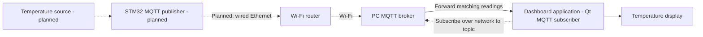

# Industrial IoT Gateway

### Embedded systems and desktop telemetry prototype

An STM32F767ZI firmware foundation paired with a Qt 6 temperature dashboard. The intended MQTT network has three members: the STM32 publisher, a broker service running on the PC, and the dashboard application as a separate subscriber client.


> **Project status:** The dashboard currently subscribes to an MQTT broker and renders temperature messages. The STM32 firmware is at the board bring-up stage and does not yet publish telemetry; the board-to-broker link is the next integration milestone.

## At A Glance

| Area | Current implementation |
| --- | --- |
| Target | STM32F767ZITx / NUCLEO-F767ZI |
| Firmware | STM32 HAL, CMSIS-RTOS v2, FreeRTOS |
| Peripherals | Ethernet RMII, USART3, USB OTG FS, GPIO |
| Dashboard | C++17, Qt Quick, Qt MQTT |
| Build systems | STM32CubeIDE and CMake |
| Intended data path | STM32 Ethernet -> Wi-Fi router -> PC broker -> dashboard subscriber |
| MQTT topic | `sensors/temperature` |

## System Overview

The target deployment has three MQTT members: the STM32 publisher, the broker service on the PC, and the Qt dashboard application as a separate subscriber. The STM32 uses wired Ethernet to connect to the Wi-Fi router; the PC reaches that router over Wi-Fi. The router carries the board's MQTT traffic to the broker on the PC. Both the STM32 and dashboard connect to the broker using the PC's Wi-Fi LAN IP address, not `localhost`.



### Firmware bring-up

The STM32 application initializes the HAL and a 96 MHz system clock, configures the board peripherals, and starts two CMSIS-RTOS v2 threads. `Heartbeat_Task` toggles LD1 every 500 ms; `defaultTask` currently sleeps. USART3 is configured for 115200 baud, 8-N-1.

The STM32 Ethernet MAC DMA descriptors and RMII pins are set up, but there is no IP stack or broker client in the current firmware. The sensor source and publish path in the diagram are planned work, not existing features. The STM32 connects to the router over Ethernet; it does not use Wi-Fi directly. Sensor acquisition, TLS, and watchdog recovery are also not implemented yet.

### MQTT temperature dashboard

The Qt Quick app is the third network member: a separate MQTT subscriber application at QoS 0. Enter the PC's Wi-Fi LAN IP address in the broker field, port `1883`, and topic `sensors/temperature`, then connect. The app displays numeric temperatures received as either a plain number (`29.5`) or a JSON object (`{"temperature":29.5}`). The broker address, port, and topic can be changed in the UI. The application no longer connects automatically on launch.

The dashboard currently uses a default MQTT connection without credentials or TLS. Use it only with a trusted development broker/network.

## Build And Run

### STM32 firmware

Requirements: STM32CubeIDE, an STM32F767ZI target (such as NUCLEO-F767ZI), and ST-LINK for flashing/debugging.

1. Import the existing STM32 project from the repository root, or open `Industrial IoT Gateway.ioc` in STM32CubeIDE.
2. Build the `Industrial IoT Gateway` project.
3. Connect ST-LINK and start the included `Industrial IoT Gateway Debug.launch` configuration (or use the IDE's Run/Debug action).

The checked-in CubeMX configuration identifies STM32Cube firmware package F7 v1.17.4. The firmware is an IDE-managed project; there is no root-level CMake or Make build.

### Qt dashboard

Requirements: Qt 6.8+ with Qt Quick and Qt MQTT, CMake 3.16+, and an MQTT broker running on the laptop. From `dashboard_application/`:

```sh
cmake -S . -B build
cmake --build build
```

Launch `build/appQtSensorDash` on Linux/macOS or `build/appQtSensorDash.exe` on Windows. If Qt is installed in a custom location, configure the Qt environment or pass `CMAKE_PREFIX_PATH` to CMake.

Start Mosquitto on the PC with a listener reachable from the LAN. Enter the PC's Wi-Fi LAN IP address in the dashboard and connect. To test publishing from another LAN device, use the same broker address:

```sh
mosquitto_pub -h <PC_LAN_IP> -p 1883 -t sensors/temperature -m '23.5'
```

Replace `<PC_LAN_IP>` with the PC's actual Wi-Fi IPv4 address. The dashboard also accepts JSON: `{"temperature":23.5}`. Invalid payloads are ignored. Configure both the STM32 MQTT client and dashboard subscriber with this PC address. Configure the broker listener and PC firewall to accept connections from the router's LAN on port 1883, and ensure Wi-Fi client isolation is disabled so the wired STM32 can reach the PC.

## Engineering Roadmap

- Read a real or simulated temperature value on the MCU and validate it over UART.
- Add an embedded IP stack and verify the board can reach the PC broker through the router.
- Run the broker on the PC and publish firmware telemetry to its LAN address using the dashboard's topic and payload contract.
- Add secure broker transport, reconnect behavior, watchdog supervision, and focused tests.

## Repository Map

| Path | Contents |
| --- | --- |
| `Core/` | Firmware application, peripheral setup, RTOS tasks, and interrupt handlers |
| `Drivers/` | CMSIS and STM32F7 HAL |
| `Middlewares/Third_Party/FreeRTOS/` | FreeRTOS kernel and CMSIS-RTOS v2 adapter |
| `Industrial IoT Gateway.ioc` | CubeMX pin, clock, peripheral, and RTOS configuration |
| `STM32F767ZITX_*.ld` | Flash and RAM linker scripts |
| `dashboard_application/` | Qt dashboard, MQTT client, CMake project, and its [build notes](dashboard_application/README.md) |

## Checks

The dashboard CI workflow currently runs `qmllint`. Its build and unit-test steps are not enabled yet; no automated firmware tests are configured.

---

**Sandeep Reddy Modugu**